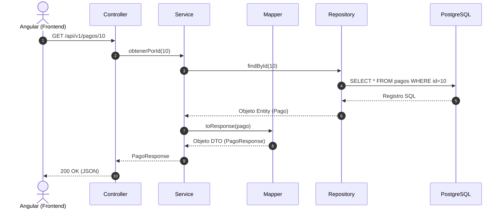
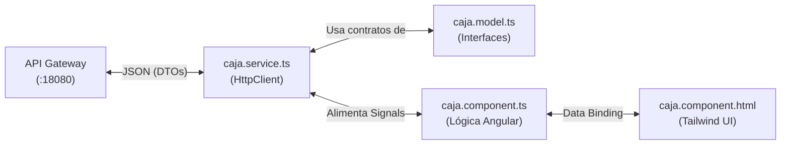

# 📘 GUÍA MAESTRA DE CAMBIOS DE ARQUITECTURA Y ESTRUCTURA (EDUSPACE)
## De la Estructura Original a la Arquitectura Limpia Modular

> **Propósito de este documento:**  
> Explicar detalladamente todos los cambios estructurales aplicados en este proyecto (Backend con capa `mapper/` y Frontend con `features/` modulares numerados) para que puedas **replicar exactamente la misma arquitectura limpia en otro proyecto**.

---

# 📑 ÍNDICE GENERAL

1. [Visión General del Cambio](#-visión-general-del-cambio)
2. [Parte 1: Transformación del BACKEND — Capa `mapper/`](#-parte-1-transformación-del-backend--capa-mapper)
   - [El Problema Anterior](#el-problema-anterior-en-backend)
   - [La Nueva Estructura con `mapper/`](#la-nueva-estructura-con-mapper)
   - [Comparativa: Antes vs Después](#comparativa-antes-vs-después-en-código)
   - [Flujo de Datos en Backend](#flujo-de-datos-con-mapper)
   - [Mapeo de Clases por Microservicio](#mapeo-de-clases-por-microservicio)
3. [Parte 2: Transformación del FRONTEND — Módulos Limpios en `features/`](#-parte-2-transformación-del-frontend--módulos-limpios-en-features)
   - [El Problema Anterior](#el-problema-anterior-en-frontend)
   - [La Nueva Estructura (12 Módulos Numerados)](#la-nueva-estructura-12-módulos-numerados)
   - [Tabla de Equivalencias: ¿Dónde estaba antes y dónde está ahora?](#tabla-de-equivalencias-antes-vs-ahora)
   - [Arquitectura Interna Estándar de Cada Vista](#arquitectura-interna-estándar-de-cada-vista)
4. [Parte 3: Guía Paso a Paso para Replicar esto en tu Otro Proyecto](#-parte-3-guía-paso-a-paso-para-replicar-en-otro-proyecto)

---

# 🎯 Visión General del Cambio

| Capa | Estructura Anterior | Nueva Estructura (Arquitectura Limpia) | Beneficio Principal |
| :--- | :--- | :--- | :--- |
| **BACKEND** | Sin carpeta `mapper/` en la mayoría de servicios. El mapeo Entity ↔ DTO se hacía manualmente dentro del `Service` mezclando reglas de negocio con transformación. | Carpeta dedicada **`mapper/`** en los 10 microservicios, con **un Mapper individual por cada Entidad** (`PagoMapper`, `CuotaMapper`, etc.). | **Principio de Responsabilidad Única (SRP):** El Service solo valida y procesa; el Mapper solo transforma. Código 70% más corto y legible. |
| **FRONTEND** | 27 carpetas desordenadas en `features/` mezclando roles (`docente`, `familia`, `secretaria`) con entidades (`alumnos`, `matriculas`, `caja`, `pagos`). Difícil saber qué vista consume qué microservicio. | **12 módulos numerados** del `01` al `12` emparejados **1 a 1** con los 10 microservicios backend, el portal público y el dashboard. | **Ubicación inmediata:** Si tocas `08-caja-pagos`, sabes que estás trabajando con `pago-ms` (:8096) y sus vistas relacionadas. |

---

# ⚙️ Parte 1: Transformación del BACKEND — Capa `mapper/`

## El Problema Anterior en Backend
En proyectos tradicionales de Spring Boot, el servicio (`Service`) solía tener dos responsabilidades distintas:
1. **Lógica de Negocio:** Validar saldos, verificar fechas, abrir caja, transacciones y publicar eventos a Kafka.
2. **Transformación de Datos:** Métodos gigantes de 50 a 100 líneas con `.builder().campo(e.getCampo()).build()` para convertir Entities a DTOs.

Esto provocaba:
- Clases `Service` infladas de 500+ líneas difíciles de mantener.
- Código repetitivo de conversión duplicado en varios servicios.
- Violación del principio SOLID de Responsabilidad Única.

---

## La Nueva Estructura con `mapper/`

Cada microservicio adopta ahora este estándar de paquetes de 8 capas:

```text
services/[microservicio]/src/main/java/pe/edu/upeu/eduspace/[modulo]/
├── entity/          ← 1. Tablas JPA mapeadas a PostgreSQL (@Entity, @Table)
├── repository/      ← 2. Interfaces Spring Data JPA (@Repository)
├── dto/             ← 3. Contratos de entrada y salida JSON (Request / Response)
├── mapper/          ← 4. NUEVA CAPA: Traductores de datos (@Component)
├── service/         ← 5. Reglas de negocio y transacciones (@Service)
├── controller/      ← 6. Endpoints REST para la API Gateway (@RestController)
├── messaging/       ← 7. Productores y consumidores de Apache Kafka
└── config/          ← 8. Seguridad, CORS, Feign y beans de Spring
```

### Principio "1 Mapper por Entidad" (Estilo Modular)
En vez de un solo archivo gigante con todas las entidades, cada entidad principal tiene su mapper propio:
- `Pago.java` ➔ `PagoMapper.java` ➔ `PagoResponse.java`
- `Cuota.java` ➔ `CuotaMapper.java` ➔ `CuotaResponse.java`
- `CajaSesion.java` ➔ `CajaSesionMapper.java` ➔ `CajaSesionResponse.java`
- `Comprobante.java` ➔ `ComprobanteMapper.java` ➔ `ComprobanteResponse.java`

---

## Comparativa: Antes vs Después en Código

### ❌ ANTES (Mapeo incrustado en el Service):
```java
@Service
@RequiredArgsConstructor
public class PagoService {
    private final PagoRepository pagoRepository;

    public PagoResponse obtenerPorId(Long id) {
        Pago p = pagoRepository.findById(id).orElseThrow();
        
        // ❌ El Service se ensucia transformando campos manualmente:
        return PagoResponse.builder()
            .id(p.getId())
            .montoTotal(p.getMontoTotal())
            .pagadorNombre(p.getPagadorNombre())
            .medio(p.getMedio())
            .estado(p.getEstado())
            .fecha(p.getPagadoEn())
            .build();
    }
}
```

### ✅ DESPUÉS (Limpio con Mapper inyectado):

**1. Creamos la clase Mapper en `mapper/PagoMapper.java`:**
```java
package pe.edu.upeu.eduspace.pago.mapper;

import org.springframework.stereotype.Component;
import pe.edu.upeu.eduspace.pago.dto.PagoResponse;
import pe.edu.upeu.eduspace.pago.entity.Pago;

@Component
public class PagoMapper {

    public PagoResponse toResponse(Pago p) {
        if (p == null) return null;
        return PagoResponse.builder()
            .id(p.getId())
            .montoTotal(p.getMontoTotal())
            .pagadorNombre(p.getPagadorNombre())
            .medio(p.getMedio())
            .estado(p.getEstado())
            .fecha(p.getPagadoEn())
            .build();
    }
}
```

**2. El `Service` solo invoca al Mapper:**
```java
@Service
@RequiredArgsConstructor
public class PagoService {
    private final PagoRepository pagoRepository;
    private final PagoMapper pagoMapper; // ✅ Inyección de dependencia limpia

    public PagoResponse obtenerPorId(Long id) {
        Pago p = pagoRepository.findById(id).orElseThrow();
        return pagoMapper.toResponse(p); // ✅ 1 sola línea, limpio y desacoplado
    }
}
```

---

## Flujo de Datos con Mapper



---

## Mapeo de Clases por Microservicio

| Microservicio | Paquete Mapper | Mappers Creados |
| :--- | :--- | :--- |
| **`auth-ms`** | `pe.edu.upeu.eduspace.auth.mapper` | `UsuarioMapper.java` |
| **`planificacion-ms`** | `pe.edu.eduspace.planificacion.mapper` | `PlanificacionMapper.java` |
| **`alumnos-ms`** | `pe.edu.eduspace.alumnos.mapper` | `AlumnoMapper.java`, `ApoderadoMapper.java` |
| **`matricula-ms`** | `pe.edu.upeu.eduspace.matricula.mapper` | `MatriculaMapper.java`, `CampaniaMapper.java`, `CupoMapper.java` |
| **`asistencia-ms`** | `pe.edu.upeu.eduspace.asistencia.mapper` | `AsistenciaMapper.java`, `JustificacionMapper.java` |
| **`tareas-ms`** | `pe.edu.upeu.eduspace.tareas.mapper` | `TareaMapper.java`, `EntregaMapper.java`, `MaterialMapper.java` |
| **`notificaciones-ms`** | `pe.edu.eduspace.notificaciones.mapper` | `NotificacionMapper.java` |
| **`pago-ms`** | `pe.edu.upeu.eduspace.pago.mapper` | `PagoMapper.java`, `CuotaMapper.java`, `CajaSesionMapper.java`, `ComprobanteMapper.java`, `TarifaMapper.java`, `ConceptoPagoMapper.java` |
| **`examenes-ms`** | `pe.edu.upeu.eduspace.examenes.mapper` | `ExamenMapper.java`, `PreguntaMapper.java`, `IntentoMapper.java` |
| **`calificaciones-ms`** | `pe.edu.upeu.eduspace.calificaciones.mapper` | `NotaMapper.java`, `CriterioMapper.java`, `BoletinMapper.java` |

---

# 🎨 Parte 2: Transformación del FRONTEND — Módulos Limpios en `features/`

## El Problema Anterior en Frontend
El directorio `frontend/src/app/features/` tenía **27 carpetas planas sin orden jerárquico**:
- Había carpetas por rol: `docente/`, `familia/`, `secretaria/`.
- Había carpetas por entidad: `alumnos/`, `matriculas/`, `caja/`, `pagos/`.
- Había carpetas secundarias sueltas: `apertura/`, `apoderados/`, `areas/`, `cuentas/`, `finanzas/`.

**¿Cuál era el problema?**
Si querías ver lo relacionado con "Pagos", tenías archivos dispersos en `caja/`, `pagos/`, `cuentas/`, `finanzas/` y `familia/pagos/`. Era imposible para un desarrollador nuevo saber qué microservicio estaba llamando cada pantalla.

---

## La Nueva Estructura (12 Módulos Numerados)

Se agruparon las 74 vistas en **12 módulos maestros**, donde los números del `01` al `10` coinciden exactamente con los 10 microservicios del Backend:

```text
frontend/src/app/features/
├── 01-auth/                 👤 [HERMES] (auth-ms :8090)
│   ├── login/               → Formulario de inicio de sesión
│   ├── cambiar-clave/       → Cambio obligatorio de contraseña
│   ├── usuarios/            → Gestión de usuarios y roles
│   └── perfil/              → Perfil del usuario autenticado
│
├── 02-planificacion/        👤 [HERMES] (planificacion-ms :8091)
│   ├── anios/               → Años lectivos y periodos bimestrales
│   ├── secciones/           → Grados y secciones (A, B, C)
│   ├── cursos/              → Catálogo de materias escolares
│   ├── aulas/               → Pabellones y ambientes físicos
│   ├── horarios/            → Generador y visor de horarios
│   ├── feriados/            → Calendario de días no laborables
│   ├── malla/               → Malla curricular por nivel
│   ├── apertura/            → Asistente guiado de inicio de año escolar
│   └── configuracion/       → Parámetros y datos del colegio
│
├── 03-alumnos/              👤 [HERMES] (alumnos-ms :8092)
│   ├── lista-alumnos/       → Buscador y tabla general de estudiantes
│   ├── alumno-detalle/      → Ficha médica, familiar y académica
│   ├── importar-alumnos/    → Carga masiva con archivo Excel/CSV
│   └── apoderados/          → Directorio de padres y tutores
│
├── 04-matriculas/           👤 [ANDRE] (matricula-ms :8093)
│   ├── matriculas/          → Lista de matrículas activas
│   ├── asistente-matricula/ → Wizard paso a paso para formalizar matrícula
│   ├── campanias/           → Campañas ordinarias y extraordinarias
│   ├── cupos/               → Control de vacantes disponibles por aula
│   ├── aprobaciones/        → Bandeja de solicitudes de admisión online
│   └── documentos/          → Emisión de constancias de matrícula en PDF
│
├── 05-asistencia/           👤 [ANDRE] (asistencia-ms :8094)
│   ├── docente-asistencia/  → Marcación rápida en aula por el profesor
│   ├── justificaciones/    → Trámite de justificación de faltas
│   ├── reporte-asistencia/  → Resumen mensual de inasistencias
│   ├── familia-asistencia/  → Vista del récord de faltas para apoderados
│   └── personal-asistencia/ → Marcaciones de docentes y trabajadores
│
├── 06-tareas/               👤 [ANDRE] (tareas-ms :8098)
│   ├── docente-tareas/      → Publicación de tareas con adjuntos
│   ├── tarea-entregas/      → Revisión y calificación de entregas
│   └── familia-tareas/      → Portal del alumno para subir tareas
│
├── 07-notificaciones/       👤 [HERMES] (notificaciones-ms :8099)
│   ├── bandeja/             → Notificaciones en tiempo real
│   └── envio-admin/         → Emisión de comunicados masivos
│
├── 08-caja-pagos/           👤 [WITMER] (pago-ms :8096)
│   ├── ventanilla-caja/     → Cobro presencial (Efectivo/Yape) y recibo R001
│   ├── cuentas-alumnos/     → Estado de cuenta corriente por alumno
│   ├── cobranza-morosos/    → Lista de deudores y recordatorios
│   ├── conceptos/           → Conceptos de cobro (matrícula, pensión)
│   ├── tarifas/             → Costos por grado fijados para el año
│   ├── descuentos/          → Políticas de becas y hermanos
│   ├── finanzas-dashboard/  → Gráficos de recaudación general
│   └── familia-pagos/       → Portal del apoderado para pagar y ver boletas
│
├── 09-examenes/             👤 [WITMER] (examenes-ms :8097)
│   ├── docente-examenes/    → Editor de exámenes con fecha y tiempo límite
│   ├── banco-preguntas/     → Repositorio de preguntas de examen
│   ├── familia-examenes/    → Lista de exámenes asignados al alumno
│   └── rendir-examen/       → Pantalla para rendir examen con cronómetro
│
├── 10-calificaciones/      👤 [WITMER] (calificaciones-ms :8095)
│   ├── docente-notas/       → Registro de notas por criterios del MINEDU
│   ├── cierre-periodo/      → Cierre oficial de bimestres/trimestres
│   ├── boletines/           → Generación masiva de libretas en PDF
│   └── familia-notas/       → Visualización de notas por padres y alumnos
│
├── 11-portal-publico/       🌐 [COMPARTIDO - WEB INSTITUCIONAL]
│   ├── inicio/              → Portada con noticias y slider
│   ├── nosotros/            → Misión, visión y directivos
│   ├── niveles/             → Inicial, Primaria y Secundaria
│   ├── admision/            → Requisitos y fechas de postulación
│   ├── matricula-en-linea/  → Preinscripción pública
│   ├── noticias/            → Blog institucional
│   └── contacto/            → Mapa, teléfono y formulario
│
└── 12-comun/                🌐 [COMPARTIDO - PANELES GENERALES]
    ├── dashboard/           → Página inicial adaptativa según rol
    ├── calendario/          → Calendario cívico y escolar
    ├── ayuda/               → Centro de soporte
    ├── mi-trabajo/          → Contrato y pagos del docente/cajero
    ├── secretaria/          → Accesos rápidos de secretaría
    └── personal/            → Directorio de colaboradores
```

---

## Tabla de Equivalencias: Antes vs Ahora

| Vista / Funcionalidad | Dónde estaba ANTES (Desordenado) | Dónde está AHORA (Modular) | Microservicio Responsable |
| :--- | :--- | :--- | :--- |
| **Login y Sesión** | `features/auth/login` | `features/01-auth/login` | `auth-ms` |
| **Gestión de Usuarios** | `features/usuarios` | `features/01-auth/usuarios` | `auth-ms` |
| **Años y Periodos** | `features/planificacion/anios` | `features/02-planificacion/anios` | `planificacion-ms` |
| **Grados y Cursos** | `features/configuracion/cursos` | `features/02-planificacion/cursos` | `planificacion-ms` |
| **Horarios Escolares** | `features/planificacion/horarios` | `features/02-planificacion/horarios` | `planificacion-ms` |
| **Padrón de Alumnos** | `features/alumnos` | `features/03-alumnos/lista-alumnos` | `alumnos-ms` |
| **Importación Excel** | `features/alumnos/importar` | `features/03-alumnos/importar-alumnos` | `alumnos-ms` |
| **Matrícula y Cupos** | `features/matriculas` | `features/04-matriculas/matriculas` | `matricula-ms` |
| **Constancias PDF** | `features/documentos` | `features/04-matriculas/documentos` | `matricula-ms` |
| **Tomar Asistencia Aula** | `features/docente/asistencia` | `features/05-asistencia/docente-asistencia` | `asistencia-ms` |
| **Justificar Faltas** | `features/asistencia/justificaciones` | `features/05-asistencia/justificaciones` | `asistencia-ms` |
| **Tareas del Docente** | `features/docente/tareas` | `features/06-tareas/docente-tareas` | `tareas-ms` |
| **Tareas del Alumno** | `features/familia/tareas` | `features/06-tareas/familia-tareas` | `tareas-ms` |
| **Ventanilla de Caja** | `features/caja` | `features/08-caja-pagos/ventanilla-caja` | `pago-ms` |
| **Cobranza y Morosos** | `features/pagos/morosos` | `features/08-caja-pagos/cobranza-morosos` | `pago-ms` |
| **Portal Pagos Familia** | `features/familia/pagos` | `features/08-caja-pagos/familia-pagos` | `pago-ms` |
| **Crear Exámenes** | `features/docente/examenes` | `features/09-examenes/docente-examenes` | `examenes-ms` |
| **Rendir Examen Online** | `features/familia/examenes/rendir` | `features/09-examenes/rendir-examen` | `examenes-ms` |
| **Registro de Notas** | `features/docente/notas` | `features/10-calificaciones/docente-notas` | `calificaciones-ms` |
| **Boletines y Libretas** | `features/calificaciones/boletines` | `features/10-calificaciones/boletines` | `calificaciones-ms` |
| **Página Web Pública** | `features/publico` | `features/11-portal-publico` | Frontend Web |
| **Panel de Inicio** | `features/dashboard` | `features/12-comun/dashboard` | Compartido |

---

## Arquitectura Interna Estándar de Cada Vista

Para que cada integrante programe de forma uniforme, cada subcarpeta de vista (por ejemplo `features/08-caja-pagos/ventanilla-caja/`) debe contener exactamente estos 4 archivos:

```text
ventanilla-caja/
├── caja.model.ts          ← 1. Modelos TypeScript (interfaces idénticas a los DTOs de Spring Boot)
├── caja.service.ts        ← 2. HttpClient para llamar a la API a través del Gateway (:18080)
├── caja.component.ts      ← 3. Lógica del componente con Angular Signals (reactividad moderna)
└── caja.component.html    ← 4. Maquetado HTML con Tailwind CSS (formularios, tablas, modales)
```



---

# 🚀 Parte 3: Guía Paso a Paso para Replicar en Otro Proyecto

Si tienes otro proyecto similar y quieres aplicar esta misma arquitectura limpia, sigue estos pasos:

### Paso 1: En el BACKEND (Microservicios)
1. **Crear la carpeta `mapper/`** en cada paquete de microservicio junto a `entity/`, `repository/`, `dto/`, `service/`, `controller/`.
2. **Crear una clase Mapper por cada Entidad principal:**
   - Anótala con `@Component`.
   - Crea el método `public MiEntidadResponse toResponse(MiEntidad e)`.
   - Si la entidad tiene una relación (`@ManyToOne`), puedes inyectar el mapper de la otra entidad en el constructor.
3. **Limpiar el `Service`:**
   - Agrega el Mapper como dependencia en el constructor del servicio (`private final MiEntidadMapper mapper;`).
   - Reemplaza todos los bloques grandes de `.builder()...` llamando a `this.mapper.toResponse(entidad)`.

### Paso 2: En el FRONTEND (Angular)
1. **Crear las carpetas numeradas** dentro de `src/app/features/` siguiendo la numeración de tus microservicios:
   - `01-[modulo1]/`
   - `02-[modulo2]/`
   - etc.
2. **Mover las vistas existentes** dentro del módulo que le corresponda según el microservicio que consume.
3. **Mantener carpetas vacías con `.gitkeep`:**
   - En Git, las carpetas vacías no se guardan a menos que tengan un archivo `.gitkeep`. Coloca un archivo `.gitkeep` vacío dentro de cada carpeta para que tus compañeros puedan clonar el repositorio y ver la estructura completa de carpetas inmediatamente.
4. **Actualizar `app.routes.ts`:**
   - Ajusta las rutas con `loadComponent` apuntando a las nuevas carpetas numeradas:
   ```typescript
   {
     path: 'caja',
     loadComponent: () => import('./features/08-caja-pagos/ventanilla-caja/caja.component').then(m => m.CajaComponent)
   }
   ```

---

## 📌 Resumen Mnemotécnico

> **Regla de Oro del Backend:**  
> *Entity se queda en la Base de Datos. DTO viaja por la Red. El Mapper es el puente entre ambos.*

> **Regla de Oro del Frontend:**  
> *Cada carpeta de `features` tiene un número que coincide con el microservicio Backend al que le hace peticiones.*
