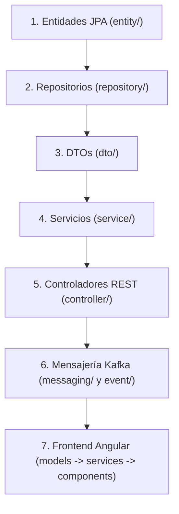
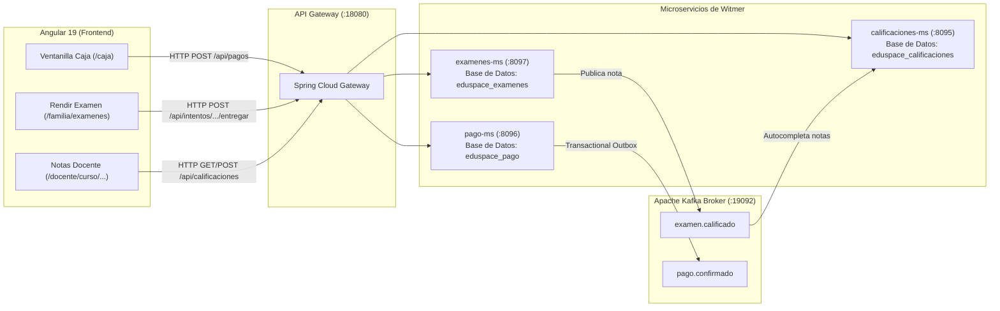

# 🚀 GUÍA MAESTRA Y CÓDIGO FUENTE COMPLETO — WITMER
## Microservicios: `pago-ms` · `examenes-ms` · `calificaciones-ms` + Frontend Angular

Bienvenido a la guía maestra de desarrollo de tu parte del proyecto **EduSpace**.  
Esta documentación fue diseñada para que puedas **vaciar todas las clases de tus carpetas o clonar un nuevo proyecto similar y programar todo desde cero por tu cuenta**, teniendo a la mano la explicación conceptual de cada archivo y su código 100% completo, probado y sin omisiones.

---

## 🛡️ PASO PREVIO RECOMENDADO (Para no perder tu avance)

Antes de borrar o vaciar los archivos en tu proyecto, abre la terminal PowerShell en la raíz del proyecto y crea una rama de práctica con Git:

```powershell
# 1. Crear y cambiarte a una rama de trabajo propia
git checkout -b practica-witmer
```

> **¿Por qué hacer esto?**  
> Porque si te equivocas, se te borra algo por accidente o quieres comparar tu avance con el código que ya funcionaba al 100%, solo tienes que ejecutar:  
> `git checkout main`  
> Y todo tu código original volverá a estar intacto. En la rama `practica-witmer` eres totalmente libre de vaciar y reescribir todo a tu ritmo.

---

## 📚 MANUALES DE CÓDIGO COMPLETO POR MÓDULO

Debido a que el código completo abarca más de **300 clases y archivos** (más de 18,000 líneas de código Java y TypeScript probadas en producción), la documentación se encuentra organizada en 4 volúmenes detallados dentro de `docs/04-witmer-pago-examenes-calificaciones/`:

| Módulo | Descripción | Archivo del Manual | Clases / Archivos |
| :--- | :--- | :--- | :---: |
| **1. Cobranza y Cuentas (`pago-ms`)** | Ventanilla de caja, emisión de recibos correlativos, cálculo de cuotas, control de concurrencia optimista, Outbox transaccional y Apache Kafka. | [📖 Ver 01-CODIGO-PAGO-MS.md](docs/04-witmer-pago-examenes-calificaciones/01-CODIGO-PAGO-MS.md) | **109 clases** |
| **2. Evaluaciones (`examenes-ms`)** | Banco de preguntas, reactivos, exámenes bimestrales, cronómetro de rendición, autocorrección instantánea y jobs de cierre automático. | [📖 Ver 02-CODIGO-EXAMENES-MS.md](docs/04-witmer-pago-examenes-calificaciones/02-CODIGO-EXAMENES-MS.md) | **69 clases** |
| **3. Calificaciones (`calificaciones-ms`)** | Registro auxiliar de notas docente, autocompletado reactivo desde Kafka, promedios ponderados, escala oficial MINEDU y boletines. | [📖 Ver 03-CODIGO-CALIFICACIONES-MS.md](docs/04-witmer-pago-examenes-calificaciones/03-CODIGO-CALIFICACIONES-MS.md) | **83 clases** |
| **4. Frontend Angular** | Ventanilla de Caja (`/caja`), Portal Familiar (`/familia/pagos`), Registro Auxiliar (`/docente/curso/:id/:sec`), Rendición de Exámenes y Boletines. | [📖 Ver 04-CODIGO-FRONTEND.md](docs/04-witmer-pago-examenes-calificaciones/04-CODIGO-FRONTEND.md) | **43 archivos** |

---

## 🧠 CÓMO FUNCIONA CADA COMPONENTE EN TU PARTE

Para cada archivo que vayas a escribir, cada uno de los manuales anteriores incluye:
1. **La ruta exacta del archivo en el proyecto** (ej. `services/pago-ms/src/main/java/pe/edu/upeu/eduspace/pago/entity/Pago.java`).
2. **Explicación detallada de qué hace la clase**:
   - Qué rol de negocio cumple.
   - Qué anotaciones JPA / Spring utiliza y por qué.
   - Cómo interactúa con otras clases, bases de datos o Kafka.
3. **El código completo, sin recortes, sin `// TODO` ni métodos abreviados**, listo para copiar o tipear.

---

## 🔄 ORDEN PEDAGÓGICO RECOMENDADO PARA CODIFICAR DESDE CERO

Cuando vacíes una carpeta o empieces a programar, **sigue siempre este orden natural de capas**:



1. **Entidades primero:** Representan las tablas en PostgreSQL. Sin entidades no puedes crear repositorios.
2. **Repositorios segundo:** Interfaces `JpaRepository` que acceden a las tablas.
3. **DTOs tercero:** Las estructuras de datos limpias que entran y salen por la API REST.
4. **Servicios cuarto:** La lógica de negocio, validaciones transaccionales y cálculos.
5. **Controladores quinto:** Endpoints HTTP (`@RestController`) que conectan Angular con el backend.
6. **Mensajería sexto:** Productores y consumidores de Kafka para comunicación asíncrona entre microservicios.
7. **Frontend séptimo:** Servicios de consumo (`HttpClient`) y componentes visuales (`.ts` y `.html`).

---

## ⚡ COMANDOS PARA COMPILAR Y VERIFICAR TU CÓDIGO

A medida que vayas escribiendo tus clases, utiliza estos comandos para verificar que compilan sin errores:

### 1. Compilar y verificar el backend Java:
```powershell
# Compilar pago-ms
mvn -f services/pago-ms/pom.xml clean compile

# Compilar examenes-ms
mvn -f services/examenes-ms/pom.xml clean compile

# Compilar calificaciones-ms
mvn -f services/calificaciones-ms/pom.xml clean compile
```

### 2. Probar la integración de tu backend (Cobro + Idempotencia + Cuotas):
```powershell
python tools/demo/proceso_witmer.py
```
> Este script ejecuta la prueba end-to-end de tu ventanilla de caja: cobro de cuotas, verificación de clave de idempotencia, prevención de sobrepago y anulación/restitución de cuotas.

### 3. Compilar y probar el Frontend Angular:
```powershell
# Compilar frontend
npm --prefix frontend run build

# Ejecutar las 274 pruebas unitarias de frontend
npm --prefix frontend test -- --watch=false --browsers=ChromeHeadless
```

---

## 🎯 RESUMEN DE LA ARQUITECTURA DE WITMER



¡Ahora tienes todo el material completo! Accede a los 4 documentos dentro de la carpeta `docs/04-witmer-pago-examenes-calificaciones/` para ver el código completo de cada clase.
