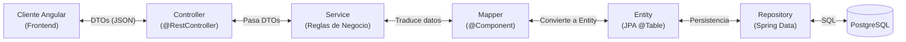

# 🔄 GUÍA MAESTRA DE MAPPERS EN LOS 10 MICROSERVICIOS

En Clean Architecture y en el desarrollo profesional con Spring Boot, la **capa de Mappers (`mapper/`)** es fundamental porque resuelve un principio clave de diseño: **Separación de Responsabilidades (Single Responsibility Principle)**.

---

## 🎯 ¿Para qué sirve la carpeta `mapper/`?

La base de datos y la API HTTP no deben estar acopladas:
- Las **Entities (`entity/`)** representan las **tablas de PostgreSQL** con relaciones JPA (`@ManyToOne`, `@OneToMany`), campos de auditoría interna y lógica de persistencia.
- Los **DTOs (`dto/`)** representan los **contratos JSON de la API REST** que viajan hacia Angular, protegiendo datos sensibles y evitando referencias circulares.
- Los **Mappers (`mapper/`)** son los **traductores oficiales**: convierten de Entity a Response DTO, y de Request DTO a Entity.



> [!TIP]
> **Beneficio clave:** El `Service` ahora solo contiene **reglas de negocio** (validar saldos, autorizaciones, eventos Kafka, transacciones). No se ensucia con cientos de líneas de `builder().campo(e.getCampo()).build()`.

---

## 📂 Ubicación del Paquete en Cada Microservicio

| Microservicio | Paquete del Mapper | Clase Mapper a Programar |
| :--- | :--- | :--- |
| **`auth-ms`** | `pe.edu.upeu.eduspace.auth.mapper` | `AuthMapper.java` |
| **`planificacion-ms`** | `pe.edu.eduspace.planificacion.mapper` | `PlanificacionMapper.java` |
| **`alumnos-ms`** | `pe.edu.eduspace.alumnos.mapper` | `AlumnoMapper.java` |
| **`matricula-ms`** | `pe.edu.upeu.eduspace.matricula.mapper` | `MatriculaMapper.java` |
| **`asistencia-ms`** | `pe.edu.upeu.eduspace.asistencia.mapper` | `AsistenciaMapper.java` |
| **`tareas-ms`** | `pe.edu.upeu.eduspace.tareas.mapper` | `TareaMapper.java` |
| **`notificaciones-ms`** | `pe.edu.eduspace.notificaciones.mapper` | `NotificacionMapper.java` |
| **`pago-ms`** | `pe.edu.upeu.eduspace.pago.mapper` | `PagoMapper.java` |
| **`examenes-ms`** | `pe.edu.upeu.eduspace.examenes.mapper` | `ExamenMapper.java` |
| **`calificaciones-ms`** | `pe.edu.upeu.eduspace.calificaciones.mapper` | `CalificacionMapper.java` |

---

## 💻 Código Fuente Completo de los Mappers

---

### 1. `auth-ms` — `AuthMapper.java`
**Ruta:** `services/auth-ms/src/main/java/pe/edu/upeu/eduspace/auth/mapper/AuthMapper.java`

```java
package pe.edu.upeu.eduspace.auth.mapper;

import org.springframework.stereotype.Component;
import pe.edu.upeu.eduspace.auth.dto.UsuarioResponse;
import pe.edu.upeu.eduspace.auth.entity.Usuario;

@Component
public class AuthMapper {

    public UsuarioResponse toResponse(Usuario u) {
        if (u == null) return null;
        return UsuarioResponse.builder()
            .id(u.getId())
            .username(u.getUsername())
            .email(u.getEmail())
            .nombres(u.getNombres())
            .apellidos(u.getApellidos())
            .rol(u.getRol())
            .activo(u.getActivo())
            .primerInicio(u.getPrimerInicio())
            .build();
    }
}
```

---

### 2. `matricula-ms` — `MatriculaMapper.java`
**Ruta:** `services/matricula-ms/src/main/java/pe/edu/upeu/eduspace/matricula/mapper/MatriculaMapper.java`

```java
package pe.edu.upeu.eduspace.matricula.mapper;

import org.springframework.stereotype.Component;
import pe.edu.upeu.eduspace.matricula.dto.*;
import pe.edu.upeu.eduspace.matricula.entity.*;

@Component
public class MatriculaMapper {

    public MatriculaResponse toResponse(Matricula m) {
        if (m == null) return null;
        return MatriculaResponse.builder()
            .id(m.getId())
            .alumnoId(m.getAlumnoId())
            .anioAcademicoId(m.getAnioAcademicoId())
            .gradoId(m.getGradoId())
            .seccionId(m.getSeccionId())
            .codigo(m.getCodigo())
            .estado(m.getEstado())
            .tipoMatricula(m.getTipoMatricula())
            .fechaMatricula(m.getFechaMatricula())
            .observaciones(m.getObservaciones())
            .build();
    }

    public CampaniaResponse toResponse(Campania c) {
        if (c == null) return null;
        return CampaniaResponse.builder()
            .id(c.getId())
            .nombre(c.getNombre())
            .anioAcademicoId(c.getAnioAcademicoId())
            .fechaInicio(c.getFechaInicio())
            .fechaFin(c.getFechaFin())
            .estado(c.getEstado())
            .build();
    }

    public CupoResponse toResponse(Cupo c) {
        if (c == null) return null;
        return CupoResponse.builder()
            .id(c.getId())
            .gradoId(c.getGradoId())
            .seccionId(c.getSeccionId())
            .totalVacantes(c.getTotalVacantes())
            .vacantesOcupadas(c.getVacantesOcupadas())
            .vacantesDisponibles(c.getTotalVacantes() - c.getVacantesOcupadas())
            .build();
    }
}
```

---

### 3. `asistencia-ms` — `AsistenciaMapper.java`
**Ruta:** `services/asistencia-ms/src/main/java/pe/edu/upeu/eduspace/asistencia/mapper/AsistenciaMapper.java`

```java
package pe.edu.upeu.eduspace.asistencia.mapper;

import org.springframework.stereotype.Component;
import pe.edu.upeu.eduspace.asistencia.dto.*;
import pe.edu.upeu.eduspace.asistencia.entity.*;

@Component
public class AsistenciaMapper {

    public AsistenciaResponse toResponse(Asistencia a) {
        if (a == null) return null;
        return AsistenciaResponse.builder()
            .id(a.getId())
            .alumnoId(a.getAlumnoId())
            .seccionId(a.getSeccionId())
            .fecha(a.getFecha())
            .estado(a.getEstado())
            .observacion(a.getObservacion())
            .registradoPor(a.getRegistradoPor())
            .creadoEn(a.getCreadoEn())
            .build();
    }

    public JustificacionResponse toResponse(Justificacion j) {
        if (j == null) return null;
        return JustificacionResponse.builder()
            .id(j.getId())
            .alumnoId(j.getAlumnoId())
            .fechaInasistencia(j.getFechaInasistencia())
            .motivo(j.getMotivo())
            .estado(j.getEstado())
            .documentoUrl(j.getDocumentoUrl())
            .revisadoPor(j.getRevisadoPor())
            .build();
    }
}
```

---

### 4. `tareas-ms` — `TareaMapper.java`
**Ruta:** `services/tareas-ms/src/main/java/pe/edu/upeu/eduspace/tareas/mapper/TareaMapper.java`

```java
package pe.edu.upeu.eduspace.tareas.mapper;

import org.springframework.stereotype.Component;
import pe.edu.upeu.eduspace.tareas.dto.*;
import pe.edu.upeu.eduspace.tareas.entity.*;

@Component
public class TareaMapper {

    public TareaResponse toResponse(Tarea t) {
        if (t == null) return null;
        return TareaResponse.builder()
            .id(t.getId())
            .cursoId(t.getCursoId())
            .seccionId(t.getSeccionId())
            .docenteId(t.getDocenteId())
            .titulo(t.getTitulo())
            .descripcion(t.getDescripcion())
            .fechaPublicacion(t.getFechaPublicacion())
            .fechaLimite(t.getFechaLimite())
            .estado(t.getEstado())
            .puntajeMaximo(t.getPuntajeMaximo())
            .build();
    }

    public EntregaResponse toResponse(Entrega e) {
        if (e == null) return null;
        return EntregaResponse.builder()
            .id(e.getId())
            .tareaId(e.getTarea().getId())
            .alumnoId(e.getAlumnoId())
            .archivoUrl(e.getArchivoUrl())
            .fechaEntrega(e.getFechaEntrega())
            .calificacion(e.getCalificacion())
            .retroalimentacion(e.getRetroalimentacion())
            .estado(e.getEstado())
            .build();
    }

    public MaterialResponse toResponse(Material m) {
        if (m == null) return null;
        return MaterialResponse.builder()
            .id(m.getId())
            .cursoId(m.getCursoId())
            .seccionId(m.getSeccionId())
            .titulo(m.getTitulo())
            .archivoUrl(m.getArchivoUrl())
            .fechaPublicacion(m.getFechaPublicacion())
            .build();
    }
}
```

---

### 5. `pago-ms` (Witmer) — `PagoMapper.java`
**Ruta:** `services/pago-ms/src/main/java/pe/edu/upeu/eduspace/pago/mapper/PagoMapper.java`

```java
package pe.edu.upeu.eduspace.pago.mapper;

import org.springframework.stereotype.Component;
import pe.edu.upeu.eduspace.pago.dto.*;
import pe.edu.upeu.eduspace.pago.entity.*;

import java.util.ArrayList;
import java.util.List;

@Component
public class PagoMapper {

    public PagoResponse toResponse(Pago p, Comprobante c) {
        if (p == null) return null;

        List<PagoResponse.PagoDetalleResponse> detResponses = new ArrayList<>();
        if (p.getDetalles() != null) {
            for (PagoDetalle d : p.getDetalles()) {
                detResponses.add(PagoResponse.PagoDetalleResponse.builder()
                    .id(d.getId())
                    .cuotaId(d.getCuota().getId())
                    .cuotaDescripcion(d.getCuota().getDescripcion())
                    .montoAplicado(d.getMontoAplicado())
                    .nuevoSaldoCuota(d.getCuota().getSaldo())
                    .nuevoEstadoCuota(d.getCuota().getEstado())
                    .build());
            }
        }

        ComprobanteResponse compResp = (c != null) ? toResponse(c) : null;

        return PagoResponse.builder()
            .id(p.getId())
            .alumnoId(p.getAlumnoId())
            .pagadorNombre(p.getPagadorNombre())
            .pagadorDocumento(p.getPagadorDocumento())
            .montoTotal(p.getMontoTotal())
            .medio(p.getMedio())
            .referencia(p.getReferencia())
            .estado(p.getEstado())
            .cajaSesionId(p.getCajaSesion() != null ? p.getCajaSesion().getId() : null)
            .registradoPor(p.getRegistradoPor())
            .pagadoEn(p.getPagadoEn())
            .aprobadoEn(p.getAprobadoEn())
            .motivoRechazo(p.getMotivoRechazo())
            .idempotencyKey(p.getIdempotencyKey())
            .comprobante(compResp)
            .detalles(detResponses)
            .build();
    }

    public ComprobanteResponse toResponse(Comprobante c) {
        if (c == null) return null;
        return ComprobanteResponse.builder()
            .id(c.getId())
            .tipo(c.getTipo())
            .serie(c.getSerie())
            .correlativo(c.getCorrelativo())
            .numeroCompleto(c.getNumeroCompleto())
            .fechaEmision(c.getFechaEmision())
            .clienteTipoDoc(c.getClienteTipoDoc())
            .clienteNumeroDoc(c.getClienteNumeroDoc())
            .clienteNombre(c.getClienteNombre())
            .montoTotal(c.getMontoTotal())
            .estado(c.getEstado())
            .hashSunat(c.getHashSunat())
            .build();
    }

    public CuotaResponse toResponse(Cuota cuota) {
        if (cuota == null) return null;
        return CuotaResponse.builder()
            .id(cuota.getId())
            .conceptoId(cuota.getConcepto().getId())
            .conceptoNombre(cuota.getConcepto().getNombre())
            .conceptoTipo(cuota.getConcepto().getTipo())
            .alumnoId(cuota.getAlumnoId())
            .matriculaId(cuota.getMatricula() != null ? cuota.getMatricula().getMatriculaId() : null)
            .mes(cuota.getMes())
            .numeroCuota(cuota.getNumeroCuota())
            .descripcion(cuota.getDescripcion())
            .fechaVencimiento(cuota.getFechaVencimiento())
            .montoOriginal(cuota.getMontoOriginal())
            .mora(cuota.getMora())
            .descuento(cuota.getDescuento())
            .montoTotal(cuota.getMontoTotal())
            .saldo(cuota.getSaldo())
            .estado(cuota.getEstado())
            .pagadoEn(cuota.getPagadoEn())
            .build();
    }

    public CajaSesionResponse toResponse(CajaSesion s) {
        if (s == null) return null;
        return CajaSesionResponse.builder()
            .id(s.getId())
            .cajeroUsuarioId(s.getCajeroUsuarioId())
            .cajeroNombre(s.getCajeroNombre())
            .fechaApertura(s.getFechaApertura())
            .montoApertura(s.getMontoApertura())
            .estado(s.getEstado())
            .saldoFinalEfectivo(s.getSaldoFinalEfectivo())
            .diferencia(s.getDiferencia())
            .cerradoEn(s.getCerradoEn())
            .observaciones(s.getObservaciones())
            .build();
    }

    public ConceptoPagoResponse toResponse(ConceptoPago c) {
        if (c == null) return null;
        return ConceptoPagoResponse.builder()
            .id(c.getId())
            .codigo(c.getCodigo())
            .nombre(c.getNombre())
            .tipo(c.getTipo())
            .recurrente(c.getRecurrente())
            .permiteDescuento(c.getPermiteDescuento())
            .activo(c.getActivo())
            .build();
    }

    public TarifaResponse toResponse(Tarifa t) {
        if (t == null) return null;
        return TarifaResponse.builder()
            .id(t.getId())
            .conceptoId(t.getConcepto().getId())
            .conceptoNombre(t.getConcepto().getNombre())
            .anioAcademicoId(t.getAnioAcademicoId())
            .gradoId(t.getGradoId())
            .nivel(t.getNivel())
            .monto(t.getMonto())
            .build();
    }
}
```

---

### 6. `examenes-ms` (Witmer) — `ExamenMapper.java`
**Ruta:** `services/examenes-ms/src/main/java/pe/edu/upeu/eduspace/examenes/mapper/ExamenMapper.java`

```java
package pe.edu.upeu.eduspace.examenes.mapper;

import org.springframework.stereotype.Component;
import pe.edu.upeu.eduspace.examenes.dto.*;
import pe.edu.upeu.eduspace.examenes.entity.*;

import java.util.Collections;
import java.util.List;
import java.util.stream.Collectors;

@Component
public class ExamenMapper {

    public ExamenResponse toResponse(Examen e) {
        if (e == null) return null;
        List<PreguntaResponse> preguntas = (e.getPreguntas() != null)
            ? e.getPreguntas().stream().map(this::toResponse).collect(Collectors.toList())
            : Collections.emptyList();

        return ExamenResponse.builder()
            .id(e.getId())
            .cursoId(e.getCursoId())
            .seccionId(e.getSeccionId())
            .docenteId(e.getDocenteId())
            .titulo(e.getTitulo())
            .descripcion(e.getDescripcion())
            .fechaInicio(e.getFechaInicio())
            .fechaFin(e.getFechaFin())
            .duracionMinutos(e.getDuracionMinutos())
            .puntajeMaximo(e.getPuntajeMaximo())
            .estado(e.getEstado())
            .preguntas(preguntas)
            .build();
    }

    public PreguntaResponse toResponse(Pregunta p) {
        if (p == null) return null;
        return PreguntaResponse.builder()
            .id(p.getId())
            .enunciado(p.getEnunciado())
            .tipo(p.getTipo())
            .puntaje(p.getPuntaje())
            .orden(p.getOrden())
            .opciones(p.getOpciones())
            .build();
    }

    public IntentoResponse toResponse(Intento i) {
        if (i == null) return null;
        return IntentoResponse.builder()
            .id(i.getId())
            .examenId(i.getExamen().getId())
            .alumnoId(i.getAlumnoId())
            .fechaInicio(i.getFechaInicio())
            .fechaFin(i.getFechaFin())
            .puntajeObtenido(i.getPuntajeObtenido())
            .estado(i.getEstado())
            .build();
    }
}
```

---

### 7. `calificaciones-ms` (Witmer) — `CalificacionMapper.java`
**Ruta:** `services/calificaciones-ms/src/main/java/pe/edu/upeu/eduspace/calificaciones/mapper/CalificacionMapper.java`

```java
package pe.edu.upeu.eduspace.calificaciones.mapper;

import org.springframework.stereotype.Component;
import pe.edu.upeu.eduspace.calificaciones.dto.*;
import pe.edu.upeu.eduspace.calificaciones.entity.*;

@Component
public class CalificacionMapper {

    public NotaResponse toResponse(Nota n) {
        if (n == null) return null;
        return NotaResponse.builder()
            .id(n.getId())
            .matriculaId(n.getMatriculaId())
            .cursoId(n.getCursoId())
            .periodoId(n.getPeriodoId())
            .criterioId(n.getCriterio().getId())
            .criterioNombre(n.getCriterio().getNombre())
            .valor(n.getValor())
            .docenteId(n.getDocenteId())
            .fechaRegistro(n.getFechaRegistro())
            .build();
    }

    public CriterioResponse toResponse(Criterio c) {
        if (c == null) return null;
        return CriterioResponse.builder()
            .id(c.getId())
            .cursoId(c.getCursoId())
            .periodoId(c.getPeriodoId())
            .nombre(c.getNombre())
            .peso(c.getPeso())
            .orden(c.getOrden())
            .build();
    }

    public BoletinResponse toResponse(Boletin b) {
        if (b == null) return null;
        return BoletinResponse.builder()
            .id(b.getId())
            .matriculaId(b.getMatriculaId())
            .periodoId(b.getPeriodoId())
            .anio(b.getAnio())
            .promedioBimestre(b.getPromedioBimestre())
            .puesto(b.getPuesto())
            .estado(b.getEstado())
            .pdfUrl(b.getPdfUrl())
            .build();
    }
}
```

---

## 🚀 Cómo usar el Mapper en un Servicio (`Service`)

Inyectar el mapper mediante el constructor (con `@RequiredArgsConstructor` de Lombok) es muy limpio:

```java
@Service
@RequiredArgsConstructor
public class PagoService {

    private final PagoRepository pagoRepository;
    private final PagoMapper pagoMapper; // Inyección de dependencia

    public PagoResponse obtenerPorId(Long id) {
        Pago pago = pagoRepository.findById(id)
            .orElseThrow(() -> new ResourceNotFoundException("Pago no encontrado: " + id));

        // El Mapper se encarga de transformar la Entity en DTO:
        return pagoMapper.toResponse(pago, pago.getComprobante());
    }
}
```

---

## 📌 Resumen de Flujo de Datos
```
Controller (recibe DTO)
   └── Service (ejecuta lógica y busca Entity en BD)
          └── Mapper (convierte Entity -> Response DTO)
                 └── Controller (devuelve Response DTO al Frontend Angular)
```
