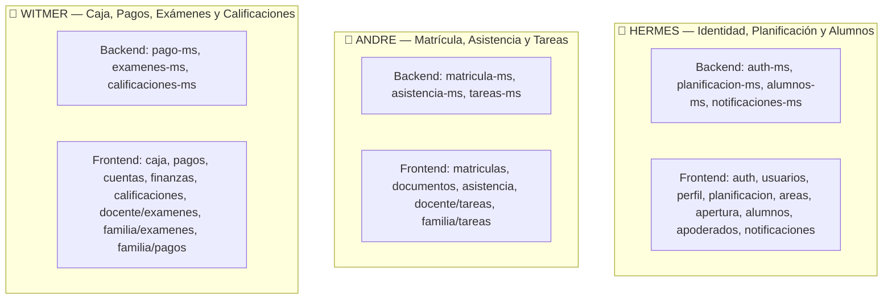

# 🚀 GUÍA MAESTRA — MANUAL COMPLETO DE TODO EL PROYECTO EDUSPACE
## 10 Microservicios Backend + Frontend Angular 19

Este directorio contiene el **código fuente 100% completo** de los 10 microservicios y todo el frontend del proyecto EduSpace, organizado para que puedas **vaciar todas las carpetas y recodificar todo el proyecto desde cero**.

> **⚠️ IMPORTANTE:** Antes de borrar cualquier archivo, crea tu rama de práctica:
> ```powershell
> git checkout -b practica-desde-cero
> ```
> Para volver al proyecto funcional en cualquier momento: `git checkout main`

---

## 📊 Resumen del Proyecto Completo

| # | Microservicio | Puerto | Base de Datos | Clases | Manual |
|:-:|:---|:---:|:---|:---:|:---|
| 1 | `auth-ms` | 8090 | `eduspace_auth` | 29 | [01-CODIGO-AUTH-MS.md](01-CODIGO-AUTH-MS.md) |
| 2 | `planificacion-ms` | 8091 | `eduspace_planificacion` | 186 | [02-CODIGO-PLANIFICACION-MS.md](02-CODIGO-PLANIFICACION-MS.md) |
| 3 | `alumnos-ms` | 8092 | `eduspace_alumnos` | 100 | [03-CODIGO-ALUMNOS-MS.md](03-CODIGO-ALUMNOS-MS.md) |
| 4 | `matricula-ms` | 8093 | `eduspace_matricula` | 64 | [04-CODIGO-MATRICULA-MS.md](04-CODIGO-MATRICULA-MS.md) |
| 5 | `asistencia-ms` | 8094 | `eduspace_asistencia` | 54 | [05-CODIGO-ASISTENCIA-MS.md](05-CODIGO-ASISTENCIA-MS.md) |
| 6 | `tareas-ms` | 8098 | `eduspace_tareas` | 58 | [06-CODIGO-TAREAS-MS.md](06-CODIGO-TAREAS-MS.md) |
| 7 | `notificaciones-ms` | 8099 | `eduspace_notificaciones` | 101 | [07-CODIGO-NOTIFICACIONES-MS.md](07-CODIGO-NOTIFICACIONES-MS.md) |
| 8 | `pago-ms` | 8096 | `eduspace_pago` | 130 | [08-CODIGO-PAGO-MS.md](08-CODIGO-PAGO-MS.md) |
| 9 | `examenes-ms` | 8097 | `eduspace_examenes` | 69 | [09-CODIGO-EXAMENES-MS.md](09-CODIGO-EXAMENES-MS.md) |
| 10 | `calificaciones-ms` | 8095 | `eduspace_calificaciones` | 83 | [10-CODIGO-CALIFICACIONES-MS.md](10-CODIGO-CALIFICACIONES-MS.md) |
| — | **Frontend Angular** | 4200 | — | 279 | [11-CODIGO-FRONTEND.md](11-CODIGO-FRONTEND.md) |
| | **TOTAL** | | | **1,153** | |

---

## 👥 Asignación del Equipo (Backend + Frontend)

Cada integrante es responsable de su dominio de punta a punta (el microservicio backend + las pantallas frontend que consumen sus endpoints):



---

## 🧭 Mapa Detallado y Contexto de Distribución de Frontend

### 1. 👤 HERMES — Módulos de Frontend (Seguridad, Estructura y Estudiantes)

| Módulo Frontend | Rutas en `app.routes.ts` | Microservicio Backend | ¿Qué hace la pantalla? (Contexto Funcional) |
| :--- | :--- | :--- | :--- |
| **`features/auth/`** | `/login`<br>`/cambiar-clave` | `auth-ms` (:8090) | Formulario de autenticación por usuario y contraseña, recuperación y cambio de clave forzado en primer inicio. Manejo del token JWT y sesión. |
| **`features/usuarios/`** | `/usuarios` | `auth-ms` (:8090) | Panel del Administrador para crear usuarios del colegio, activar/bloquear cuentas y asignar roles (`ADMIN`, `DOCENTE`, `CAJERO`, `SECRETARIA`, `APODERADO`, `ALUMNO`). |
| **`features/perfil/`** | `/mi-perfil` | `auth-ms` (:8090) | Vista personal del usuario con sus datos básicos, foto y opción de cambiar contraseña. |
| **`features/planificacion/`** | `/planificacion/anios`<br>`/planificacion/secciones`<br>`/planificacion/cursos`<br>`/planificacion/aulas`<br>`/planificacion/malla`<br>`/planificacion/horarios`<br>`/planificacion/feriados` | `planificacion-ms` (:8091) | El corazón académico del colegio: apertura de años escolares, creación de grados y secciones (A, B, C), catálogo de materias/cursos por nivel, asignación de aulas físicas, generador de horarios escolares y registro de feriados. |
| **`features/configuracion/`** | `/configuracion`<br>`/configuracion/colegio`<br>`/configuracion/grados`<br>`/configuracion/cursos`<br>`/configuracion/areas` | `planificacion-ms` (:8091) | Panel institucional: datos del colegio (logo, RUC, dirección), configuración curricular del MINEDU y oferta académica. |
| **`features/areas/` y `apertura/`** | `/areas`<br>`/areas/:codigo`<br>`/apertura` | `planificacion-ms` (:8091) | Vista general de las áreas de trabajo institucional y asistente guiado para abrir un nuevo año académico paso a paso. |
| **`features/alumnos/`** | `/alumnos`<br>`/alumnos/:id`<br>`/alumnos/importar` | `alumnos-ms` (:8092) | Padrón oficial de estudiantes: ficha integral del alumno, historial médico/familiar, búsqueda rápida y carga masiva mediante archivo Excel/CSV. |
| **`features/apoderados/`** | `/apoderados` | `alumnos-ms` (:8092) | Directorio de padres de familia y apoderados legales vinculados a sus hijos. |
| **`features/notificaciones/`** | `/notificaciones`<br>`/notificaciones/envio` | `notificaciones-ms` (:8099) | Bandeja de entrada de avisos y notificaciones del usuario; y panel de emisión de comunicados masivos por correo/sistema para directivos. |

---

### 2. 👤 ANDRE — Módulos de Frontend (Admisión, Matrícula, Asistencia y Tareas)

| Módulo Frontend | Rutas en `app.routes.ts` | Microservicio Backend | ¿Qué hace la pantalla? (Contexto Funcional) |
| :--- | :--- | :--- | :--- |
| **`features/matriculas/`** | `/matriculas`<br>`/matriculas/campanias`<br>`/matriculas/cupos`<br>`/matriculas/aprobaciones`<br>`/matricula/asistente` | `matricula-ms` (:8093) | Ciclo completo de matrícula: creación de campañas escolares, control de cupos y vacantes disponibles por grado, bandeja de solicitudes para aprobar o rechazar, y asistente interactivo para matricular a un estudiante. |
| **`features/documentos/`** | `/documentos` | `matricula-ms` (:8093) | Generador y descargador de constancias oficiales de matrícula, fichas de inscripción y contratos escolares en PDF. |
| **`features/asistencia/`** | `/asistencia/justificaciones`<br>`/asistencia/reporte` | `asistencia-ms` (:8094) | Panel administrativo de asistencia escolar: gestión y aprobación de cartas de justificación médica/familiar y reportes de inasistencias o tardanzas. |
| **`features/personal/asistencia`** | `/personal/asistencia` | `asistencia-ms` (:8094) | Control de asistencia diaria y marcaciones de docentes y personal del colegio. |
| **`features/docente/asistencia/`** | `/docente/asistencia` | `asistencia-ms` (:8094) | Pantalla del profesor en el aula para pasar lista diaria (Presente, Falta, Tardanza, Justificado) con un solo clic. |
| **`features/familia/asistencia/`** | `/familia/asistencia` | `asistencia-ms` (:8094) | Portal de los padres para consultar el récord de asistencia y faltas de sus hijos en tiempo real. |
| **`features/docente/tareas/`** | `/docente/tareas`<br>`/docente/tareas/:id` | `tareas-ms` (:8098) | Pantalla del profesor para publicar tareas con fecha límite y archivos adjuntos, revisar entregas de los alumnos y asignarles retroalimentación. |
| **`features/familia/tareas/`** | `/familia/tareas` | `tareas-ms` (:8098) | Vista del alumno y apoderado con la lista de tareas pendientes, descarga de materiales de clase y subida de archivos de entrega. |

---

### 3. 👤 WITMER — Módulos de Frontend (Caja, Cobranza, Exámenes y Calificaciones)

| Módulo Frontend | Rutas en `app.routes.ts` | Microservicio Backend | ¿Qué hace la pantalla? (Contexto Funcional) |
| :--- | :--- | :--- | :--- |
| **`features/caja/`** | `/caja`<br>`/caja/personal` | `pago-ms` (:8096) | Ventanilla de cobro en tiempo real: apertura y cierre de caja, cobro en efectivo, Yape, Plin o transferencia, emisión e impresión de boletas/recibos oficiales (R001-...), y arqueo diario. |
| **`features/pagos/`** | `/pagos/cuentas`<br>`/pagos/cobranza`<br>`/pagos/conceptos`<br>`/pagos/tarifas`<br>`/pagos/descuentos`<br>`/pagos/morosos` | `pago-ms` (:8096) | Gestión financiera del colegio: configuración de conceptos (matrícula, pensión), tarifas del año, políticas de descuentos por hermanos o becas, cuentas corrientes de cada alumno y listado de deudores morosos. |
| **`features/finanzas/`** | `/finanzas` | `pago-ms` (:8096) | Dashboard con métricas de recaudación diaria, mensual, ingresos proyectados vs cobrados e informes para dirección. |
| **`features/familia/pagos/`** | `/familia/pagos` | `pago-ms` (:8096) | Portal del padre de familia: estado de cuenta de sus hijos, visualización de cuotas pagadas/pendientes y descarga de recibos en PDF. |
| **`features/docente/examenes/`** | `/docente/examenes`<br>`/docente/banco` | `examenes-ms` (:8097) | Editor de evaluaciones para el profesor: banco de preguntas de opción múltiple o abiertas, configuración de tiempo de duración y fecha de examen. |
| **`features/familia/examenes/`** | `/familia/examenes`<br>`/familia/examenes/:id/rendir` | `examenes-ms` (:8097) | Entorno seguro para que el estudiante rinda sus exámenes en línea con cronómetro descendente y envío automático al finalizar. |
| **`features/docente/notas/`** | `/docente/notas` | `calificaciones-ms` (:8095) | Cuaderno de notas digital del profesor: registro de calificaciones por competencias y capacidades del MINEDU con ponderación automática. |
| **`features/calificaciones/`** | `/calificaciones/cierre`<br>`/calificaciones/boletines` | `calificaciones-ms` (:8095) | Cierre oficial de bimestres/trimestres, consolidado de actas de notas y generación masiva de libretas escolares. |
| **`features/familia/notas/` y `boletines/`** | `/familia/notas`<br>`/familia/boletines` | `calificaciones-ms` (:8095) | Consulta de notas en tiempo real por los padres y descarga del boletín de notas bimestral oficial en PDF. |

---

### 4. 🌐 Módulos Transversales / Compartidos (Infraestructura Frontend)

- **`frontend/src/app/core/`**: No pertenece a una persona individual; contiene los cimientos compartidos:
  - `guards/`: `authGuard` (valida token JWT) y `roleGuard` (valida permisos de rol).
  - `interceptors/`: `jwt.interceptor` (adjunta el header `Authorization: Bearer <token>`).
  - `services/`: `auth.service.ts` (mantiene el estado del usuario activo con Signals).
- **`frontend/src/app/shared/`**: Componentes reutilizables por todos: Navbar, Sidebar, Modales de confirmación, Spinners de carga.
- **`frontend/src/app/features/publico/`**: El portal institucional de acceso libre sin login (`/`, `/nosotros`, `/niveles`, `/admision`, `/contacto`).

---

## 🏛️ Arquitectura Limpia Para Codificar Cada Feature en Frontend

Para que el código sea limpio, predecible y fácil de programar por cualquiera de los 3 integrantes, cada carpeta de `feature` debe estructurarse así:

```text
features/
└── [modulo]/                        # Ej: alumnos, matriculas, caja
    ├── models/                      # 1. Contratos TypeScript (Interfaces)
    │   └── [modulo].model.ts        # Tipos de datos que coinciden con los DTOs del backend
    │
    ├── services/                    # 2. Cliente HTTP (Inyección de dependencias)
    │   └── [modulo].service.ts      # Funciones get(), post(), put(), delete() al API Gateway
    │
    ├── components/                  # 3. Componentes visuales
    │   ├── [modulo]-list/           # Vista de listado / tabla
    │   │   ├── [modulo]-list.component.ts
    │   │   └── [modulo]-list.component.html
    │   └── [modulo]-form/           # Modal o formulario de creación/edición
    │       ├── [modulo]-form.component.ts
    │       └── [modulo]-form.component.html
    │
    └── [modulo].routes.ts           # (Opcional) Rutas si el módulo es grande
```

### Guía de Implementación Paso a Paso:

#### Paso 1: Definir la interfaz de datos (`[modulo].model.ts`)
```typescript
export interface Alumno {
  id: number;
  nombres: string;
  apellidos: string;
  documentoNumero: string;
  gradoId: number;
  estado: 'ACTIVO' | 'INACTIVO';
}
```

#### Paso 2: Crear el servicio HTTP (`[modulo].service.ts`)
```typescript
@Injectable({ providedIn: 'root' })
export class AlumnoService {
  private http = inject(HttpClient);
  private apiUrl = '/api/v1/alumnos'; // Pasa a través del Spring Cloud Gateway (:18080)

  listar(): Observable<Alumno[]> {
    return this.http.get<Alumno[]>(this.apiUrl);
  }

  crear(alumno: Partial<Alumno>): Observable<Alumno> {
    return this.http.post<Alumno>(this.apiUrl, alumno);
  }
}
```

#### Paso 3: Lógica del componente con Angular Signals (`[modulo].component.ts`)
```typescript
@Component({
  selector: 'app-alumnos',
  standalone: true,
  imports: [CommonModule, FormsModule],
  templateUrl: './alumnos.component.html'
})
export class AlumnosComponent implements OnInit {
  private alumnoService = inject(AlumnoService);

  // Estados reactivos con Signals
  alumnos = signal<Alumno[]>([]);
  cargando = signal<boolean>(false);

  ngOnInit() {
    this.cargar();
  }

  cargar() {
    this.cargando.set(true);
    this.alumnoService.listar().subscribe({
      next: (data) => {
        this.alumnos.set(data);
        this.cargando.set(false);
      },
      error: () => this.cargando.set(false)
    });
  }
}
```

---

## 🔄 Orden Recomendado Para Codificar Desde Cero

### Backend — Orden por Capas (dentro de cada microservicio):

```
1. entity/       → Primero: las tablas de la base de datos (PostgreSQL)
2. repository/   → Segundo: interfaces Spring Data JPA de acceso a datos
3. dto/          → Tercero: objetos de entrada y salida de la API REST (JSON)
4. mapper/       → Cuarto: traductores de datos entre Entity y DTO (ver GUIA-MAPPERS.md)
5. service/      → Quinto: lógica de negocio, validaciones y transacciones
6. controller/   → Sexto: endpoints REST expuestos al API Gateway
7. messaging/    → Séptimo: productores y consumidores de eventos Kafka
8. config/       → Octavo: configuraciones de Spring Boot, seguridad y CORS
```

> 📖 **Guía de Mappers:** Para ver el código fuente y cómo programar los mappers de los 10 microservicios, consulta [GUIA-MAPPERS.md](GUIA-MAPPERS.md).

### Backend — Orden por Microservicio (los que dependen de otros van después):

```
1. auth-ms           → No depende de nadie. Login y JWT.
2. planificacion-ms   → No depende de nadie. Base de la estructura académica.
3. alumnos-ms         → Puede consultar planificacion-ms.
4. matricula-ms       → Depende de planificacion-ms y alumnos-ms.
5. asistencia-ms      → Escucha eventos de matricula-ms.
6. tareas-ms          → Escucha eventos de matricula-ms.
7. examenes-ms        → Escucha eventos de matricula-ms.
8. calificaciones-ms  → Escucha eventos de examenes-ms y tareas-ms.
9. pago-ms            → Escucha eventos de matricula-ms.
10. notificaciones-ms → Escucha eventos de TODOS los demás.
```

### Frontend — Estructura por Módulo Funcional:

```
frontend/src/app/
├── core/                    → Modelos, servicios HTTP, guards, interceptores
│   ├── models/              → Interfaces TypeScript (tipado de datos)
│   ├── services/            → Servicios HTTP (@Injectable)
│   ├── guards/              → Protección de rutas por rol
│   ├── interceptors/        → Headers JWT y manejo de errores
│   ├── config/              → Configuración de autenticación
│   └── utils/               → Funciones auxiliares
├── shared/                  → Componentes reutilizables (modal, buscador, paginador)
├── features/                → Un módulo por cada pantalla/funcionalidad
│   ├── auth/                → Login, registro
│   ├── dashboard/           → Página de inicio por rol
│   ├── caja/                → Ventanilla de caja (cajero)
│   ├── docente/             → Notas, exámenes, tareas del profesor
│   ├── familia/             → Portal alumno/apoderado: notas, pagos, exámenes
│   ├── alumnos/             → CRUD de alumnos
│   ├── matriculas/          → Proceso de matrícula
│   ├── configuracion/       → Config. del colegio, grados, secciones
│   ├── pagos/               → Admin de tarifas, conceptos, morosos
│   ├── calificaciones/      → Boletines, cierre de periodo
│   ├── planificacion/       → Cursos, horarios
│   └── ...                  → Otros módulos funcionales
├── app.routes.ts            → Rutas principales con lazy loading
├── app.component.ts         → Componente raíz
└── app.config.ts            → Providers de la aplicación
```

---

## ⚡ Comandos Para Compilar y Verificar

```powershell
# Compilar un microservicio específico (reemplaza NOMBRE):
mvn -f services/NOMBRE/pom.xml clean compile

# Compilar TODOS los microservicios:
@('auth-ms','planificacion-ms','alumnos-ms','matricula-ms','asistencia-ms','tareas-ms','notificaciones-ms','pago-ms','examenes-ms','calificaciones-ms') | ForEach-Object { Write-Host "Compilando $_..."; mvn -f "services/$_/pom.xml" compile -q }

# Compilar el frontend:
npm --prefix frontend run build

# Levantar el frontend en modo desarrollo:
npm --prefix frontend start
```

---

## 🏗️ Arquitectura General del Sistema

```
                    ┌─────────────┐
                    │  Frontend   │  Angular 19
                    │  :4200      │  Signals + Standalone
                    └──────┬──────┘
                           │ HTTP
                    ┌──────▼──────┐
                    │  Gateway    │  Spring Cloud Gateway
                    │  :18080     │  Proxy + JWT
                    └──────┬──────┘
                           │
          ┌────────────────┼────────────────┐
          │                │                │
    ┌─────▼─────┐   ┌─────▼─────┐   ┌─────▼─────┐
    │ auth-ms   │   │planific-ms│   │alumnos-ms │   ... (10 servicios)
    │ :8090     │   │ :8091     │   │ :8092     │
    └───────────┘   └───────────┘   └───────────┘
          │                │                │
          └────────────────┼────────────────┘
                           │ Kafka (eventos)
                    ┌──────▼──────┐
                    │  Apache     │
                    │  Kafka      │
                    │  :19092     │
                    └─────────────┘
```
